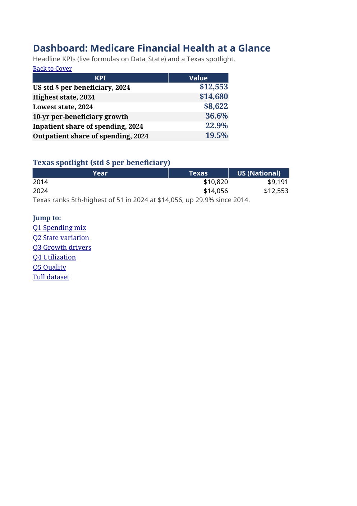

Portfolio project - Real CMS public data - Interactive Excel dashboard

## The business question

Which states drive Medicare fee-for-service spending, and does more spending buy better quality?



## Key findings

- **Inpatient (22.9%) + outpatient (19.5%) hospitals absorb 42 cents of every Medicare dollar** ($348.5B total, 2024).
- **Florida spends 70% more per beneficiary than Hawaii** ($14,680 vs $8,622) - after CMS strips out price differences, so the gap is utilization, not prices.
- **Per-beneficiary spending rose 36.6% in a decade**, and the site of care moved: outpatient gained the 5.6 share points inpatient lost.
- **It is volume, not prices**: spending tracks inpatient stays almost one-for-one across states (r = 0.81).
- **More spending does not buy fewer bounce-backs**: higher-spending states have higher 30-day readmission rates (r = 0.63). Utah readmits 13.4%; DC readmits 20.4%.

## What this project demonstrates

- State-level financial analysis on 11 years of real CMS public data (51 geographies x 11 years)
- Standardized (price-adjusted) payment methodology for fair geographic comparison
- Live Excel formulas (SUMIFS / MAXIFS / MINIFS) plus DAX equivalents for Power Pivot
- Validated metrics with a full data-quality log

## Explore the project

| Asset | Purpose |
|---|---|
| [Excel workbook](dashboard/Medicare_Financial_Analysis_2014_2024.xlsx) | Interactive dashboard: 5 questions, charts, live formulas |
| [DAX measures](dax/measures.md) | Metric definitions in Excel and DAX |
| [Methodology](docs/methodology.md) | Standardized payments, population, exclusions |
| [Data dictionary](docs/data-dictionary.md) | Field definitions |
| [Validation log](docs/validation-log.md) | Data quality checks |

## Data

CMS Medicare Fee-for-Service Geographic Variation Public Use File, National/State/County edition ([data.cms.gov](https://data.cms.gov)), 2014-2024. Public domain.

## Reproduce

```bash
python3 build_workbook.py   # rebuilds the workbook from the CMS download (pandas + openpyxl)
```
